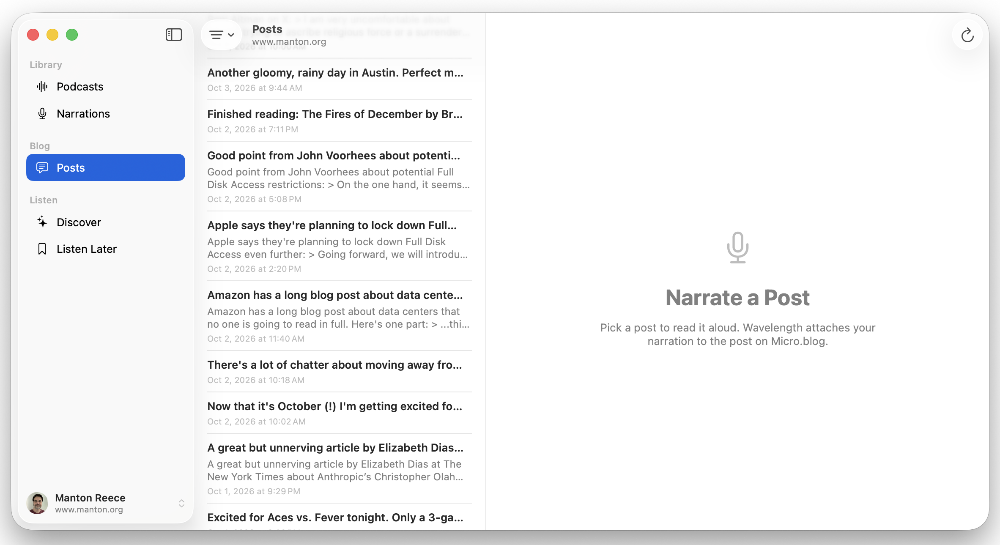

# Wavelength for Mac

Wavelength is a native macOS podcast studio for Micro.blog. Record, edit, and publish microcasts, narrate your posts, and listen to podcasts from Discover.

It mirrors the Expo app in `../wavelength-react`: the same Micro.blog API calls, the same `episode.json` and `segment-N.m4a` episode layout, and the same 128 kbps mono MP3 on publish.



## Requirements

- macOS 26 or later
- Xcode 26 or later
- [XcodeGen](https://github.com/yonaskolb/XcodeGen) (`brew install xcodegen`)

## Getting started

The Xcode project is generated from `project.yml` and isn't checked in. Generate it, then open it:

```bash
xcodegen generate
open Wavelength.xcodeproj
```

Run `xcodegen generate` again after adding or removing files.

The app is signed with the Micro.blog developer team (`3F9MDJ6K4E`), so you need to be a member of that team in Xcode to build it.

## Sparkle updates

Wavelength uses Sparkle for direct downloads. The **Check for Updates…** command is available in builds that include an HTTPS appcast URL and a Sparkle public key. Checks and installs are manual for now.

The appcast URL and public key are configured in `project.yml`. The private signing key lives in Keychain under the Sparkle account `blog.micro.wavelength`.

For update testing, override `WAVELENGTH_UPDATE_FEED_URL` when archiving to point at a separate HTTPS feed. Increase `CURRENT_PROJECT_VERSION` for each update.

```bash
xcodebuild -project Wavelength.xcodeproj -scheme Wavelength \
  -configuration Release -archivePath build/Wavelength.xcarchive \
  -clonedSourcePackagesDirPath build/SourcePackages archive
```

Export the archive using Developer ID, notarize the app, and staple the ticket. Run the release script with the app path, version, and build number. The script looks for Sparkle tools in `build/SourcePackages/artifacts/sparkle/Sparkle/bin`. Set `SPARKLE_BIN` if Xcode resolved the package elsewhere.

```bash
Scripts/release.sh /path/to/Wavelength.app 1.0 1
```

The script writes `Wavelength_1.0.zip` in the current directory and prints the signed enclosure XML. Upload the ZIP, then paste the enclosure into the release item in `wavelength.xml` and publish the appcast. Test updating from a lower build number through installation and relaunch on the test feed before publishing a production update.

## Tests

```bash
xcodebuild -project Wavelength.xcodeproj -scheme Wavelength -destination 'platform=macOS' test
```

## Layout

- `Wavelength/API` holds the Micro.blog clients (IndieAuth, Micropub, Discover).
- `Wavelength/Stores` holds the observable app state, one store per feature.
- `Wavelength/Storage` holds the episode and narration folders and the Keychain.
- `Wavelength/Audio` holds recording, editing, waveform analysis, MP3 encoding, and playback.
- `Wavelength/Views` holds the SwiftUI screens.
- `Packages/LAME` is LAME 3.100, built from source for MP3 encoding.
